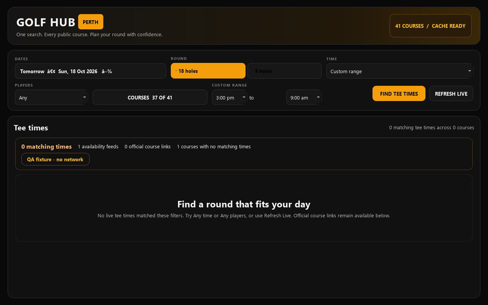
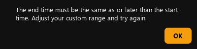
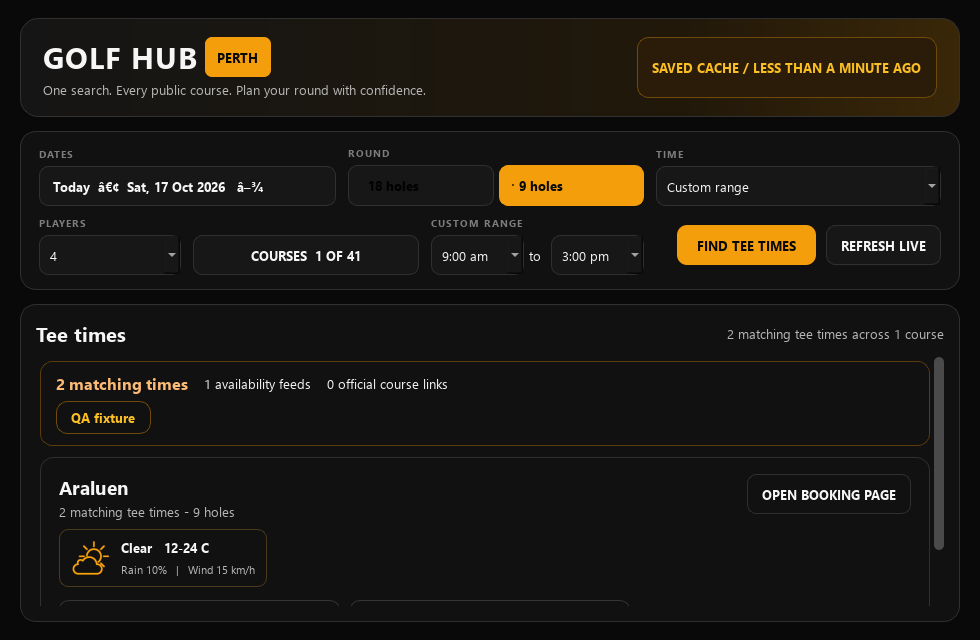
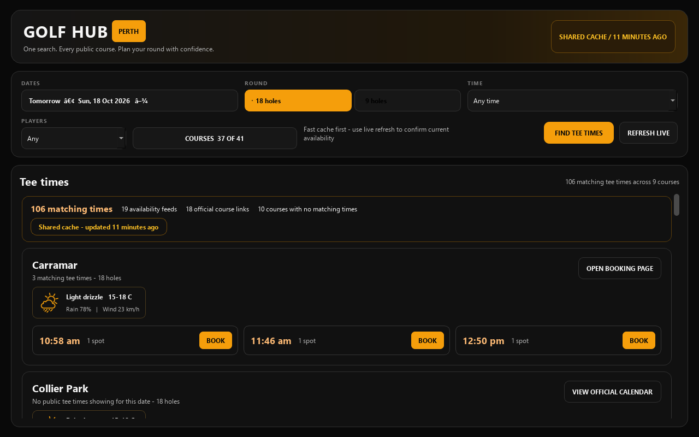

# QA pass: 17 October 2026 Perth

## Scope and provenance

Base: `Jarryd22/golfhub-perth` main `25de15b65af6f9dcad4a4d13788fb87ab976df31`. Fresh separate clone; the user's older checkout and its extensive uncommitted work were read only. That checkout is based on `3450207` and includes newer desktop/mobile source that is absent from remote main. This report does not establish the quality of the installed releases.

Inspected app tasks, remote branches, all six open drafts (#3–8), and open GitHub issues (none). No duplicate changes to Quick18, weather preparation, forecast validity or Wembley collection. This draft is independent of those branches. Their dependencies remain #4→#6→#8 and #5→#7. The older checkout's AGENTS release policy was read; remote main contains no AGENTS.md or separate software-engineering instruction file.

Environment: Windows, Python 3.14.4, PySide6 6.11.1, Qt offscreen platform. Application and temporary data were isolated under this task. Source widgets were constructed, rendered, clicked and queried through Qt/QTest. Native desktop automation was not exposed by the available tools. No installer, physical-device Android, TalkBack, native screen reader, or display-scaling check was performed. ADB enumeration could not start its server in the sandbox; no device was changed. Mobile findings are read-only inspection of local-only code.

## Changes

1. **Perth booking day:** a UTC clock converted through `Australia/Perth` now supplies startup bounds, TODAY banner/highlight and Today/Tomorrow labels. At 16:00 UTC the date advances in Perth even if the computer's date does not. The 28-day range/default tomorrow behavior is retained. This does not automatically rebase an already-open search window at midnight.
2. **Invalid custom ranges:** a start later than the end now opens a readable themed explanation before starting/queuing a search. Existing results and selections remain; focus returns to End time. Equal endpoints and one-sided Any bounds remain valid. Start/end controls have distinct accessible names.

Before: a 3pm→9am range accepted `[900, 540]` and showed “0 matching times” against a fixture containing a 10am tee time. The four relevant new range assertions failed before the guard. Both injected-Perth widget assertions failed on baseline. After: all 11 new regression tests pass.

## Test results

- **132/133 tests passed** across 16 isolated module processes; the one failure is the same baseline cron expectation at `tests/test_golfhub_v3.py:234`. Baseline was 121/122. See [module summary](test-summary.json).
- All 6 Perth-date and 5 time-range tests passed. The affected 5-test range suite was rerun after styling the real validation dialog. Existing 12 calendar and 4 search-race tests passed.
- All 9 booking-dialog tests passed with static local HTML fixtures. A sandboxed WebEngine launch initially failed; an authorized local rerun succeeded with Chromium's sandbox unchanged. No live holds or booking actions occurred.
- 43 existing cache tests passed. Temporary-directory permission failures in the initial sandbox run disappeared after `TEMP/TMP` were pointed at workspace directories.
- [Reusable smoke tool](../../../scripts/qa_desktop_smoke.py) completed 16 named checks through real Qt widgets: first launch, course name search, cache request/render, intercepted booking URL, group/time filter, 9-hole request/link, nonconsecutive dates, offline with/without saved data, provider error, unavailable weather, empty results, invalid/corrected range, and three window sizes. [Full smoke report](smoke-report.json).
- The smoke report is **completed with known findings**, not an all-clear: 42 course-checkbox callback errors (the existing signal mismatch), empty Players/course-checkbox accessibility names, and existing broken date punctuation. Those were not hidden or treated as passes. The count fix and punctuation fix already exist in the dirty local checkout.
- Visual inspection: 980×640, 1280×800 and 1600×1000 source windows; validation message has readable light text on dark background. Primary search actions remain visible in the compact fixture; results scroll vertically. No native scaling/zoom or full accessibility conformance claim.
- Whitespace check and independent code review passed. No workflow file was changed; existing PR CI only covers cache tests, so local Qt evidence matters.

## Published-data check

Read one public shared-cache snapshot for **18 October / 18 holes** through GitHub, then rendered it locally with provider networking blocked. Blob `3d740d4fd381c9b0db0b1eec2ace51a1fab2b38c`, generated `2026-10-16T23:16:23+00:00`: 37 course records, 106 tee rows, 37 weather records, no error/stale flags. Qt summary reported 106 matching times. This verifies that one published payload can be consumed; it does not verify current provider availability or forecast truth. [Captured metadata](published-cache-render.json).

No production workflow was dispatched. No merge, deployment, release, credentials/security change, booking, real notification, payment or third-party communication was performed.

## Follow-up

Use the [regression checklist](../../QA_CHECKLIST.md) for subsequent passes and the [prioritized backlog](../../IMPROVEMENT_BACKLOG.md) for evidence, expected benefits and duplicate-work boundaries. The most important next decision is which existing local/mobile candidate should become the canonical tested source. Keyboard date selection and unnamed controls are confirmed accessibility work; mobile map freshness and keyboard/tap-target concerns need a separate device/widget reproduction.
