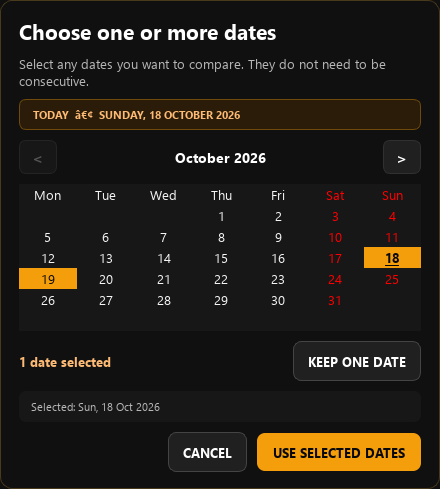
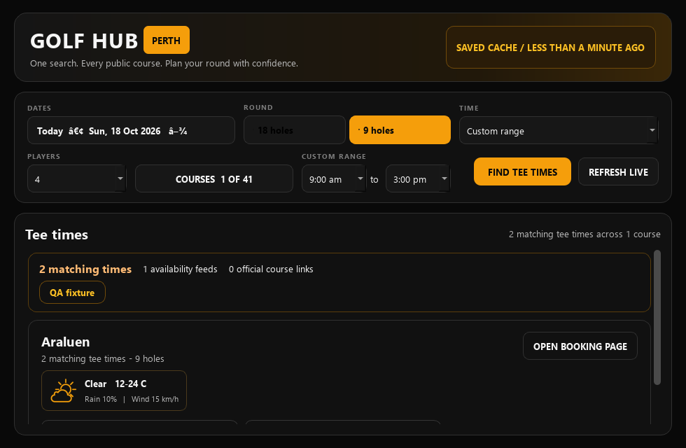

# QA pass: 18 October 2026 Perth

## Scope and source choice

Today's isolated branch follows draft [#9](https://github.com/Jarryd22/golfhub-perth/pull/9) at `6da0074de11999a5382d00822ee9cacfc1def0a4`; it targets that branch so the new diff contains only today's repair and evidence. Remote main remains `25de15b65af6f9dcad4a4d13788fb87ab976df31`. Drafts #3-9 and existing tasks/remote branches were inspected; none were merged or deployed. Yesterday's [report](../2026-10-17/REPORT.md), [checklist](../../QA_CHECKLIST.md) and [backlog](../../IMPROVEMENT_BACKLOG.md) remain the cumulative starting point.

The original checkout stays at `3450207`, with 24 modified tracked files, 627 untracked files, no staged changes and no tracked deletions. Its desktop source declares 5.1.17 and mobile source 0.1.22+23, beyond the remote desktop 5.0 source line. Read-only Git plumbing was used because ordinary status reports a work-tree error. No relevant repository `.agents/skills` exists; the local AGENTS/release policy requires separate explicit release authorization. The newer source's freshness, course-count, punctuation and mobile work was preserved rather than copied. Canonical source reconciliation remains a decision for the owner.

Environment: Windows, Python 3.14.4, PySide6 6.11.1, Qt offscreen. Test state/temp directories were isolated. The computer-use skill was read; this session has no callable native Windows driver. All UI evidence below is source-widget interaction, not an installed release, physical Android device, screen reader or DPI test.

## Focused change and before/after evidence

Before: open the date button with Space, press Right then Enter on the actually focused `qt_calendar_calendarview`. The cursor moves October 18 to 19, but the chosen set remains October 18 and says **1 date selected**. The new eight-test suite produces eight assertion failures across six failing test methods on untouched #9 (the navigation-only and mouse tests pass).

The newer local calendar already has a parent `keyPressEvent`, but the focused child consumes Return/Enter/Space first. A separate read-only probe reproduced the same failure there; direct delivery to the parent would misleadingly appear to work. [Local-source probe](local-calendar-probe.json).

After: a focused-table event filter emits one keyboard activation for Return, Enter or Space. Arrow movement stays separate from selection, held keys do not repeatedly toggle, at least one chosen date remains, and Tab/Space applies while Escape discards pending changes. Mouse click/double-click keeps its existing single-toggle behavior. The picker explains the keys and has an accessible name/description. Qt's asynchronous numeric date editor is disabled for this arrow-driven picker: independent review found that otherwise Enter could toggle the old date before a typed date committed. That sequence now has a regression test.

[Before input evidence](keyboard-before.json) · [After input evidence](keyboard-after.json) · [Baseline failures](keyboard-baseline.log)

## Validation

- **140/141 branch test cases pass**, combining isolated module runs and the successful nine-test local-HTML booking-dialog run. The sole failure is the unchanged obsolete cron assertion in `test_golfhub_v3.py:234` (`*/10` versus the existing offset schedule). [Module evidence](test-summary.json). No cron or production workflow change was made.
- All **8 new keyboard regressions** pass, including actual focused-view input, three activation keys, month/bounds navigation, minimum-one selection, autorepeat, Tab/apply, Escape/cancel, numeric editor delay and mouse double-click. All **11 PR #9 regressions** and **12 existing multi-date / 4 search-race** tests pass. This rechecks #9 locally and does not claim it is deployed.
- Chromium's process launch was blocked by the local execution sandbox. The nine booking-dialog tests passed with ordinary Chromium sandbox protections intact under authorized local execution, using static HTML only; no provider holds/bookings occurred.
- Real offscreen Qt smoke completed **16 journey/layout checks**: first-launch construction, course-name search, cache search/render, intercepted booking handoff, 9/18 holes, group/time filters, multiple dates, empty/error/offline with/without saved data, unavailable weather, range correction and 980x640/1280x800/1600x1000 windows. [Smoke evidence](smoke-report.json). This remains `completed_with_known_findings`: 42 existing course-checkbox callback errors, unnamed Players/course checkboxes and broken date punctuation persist.
- **148 course/date/round combinations** across two days and both rounds passed static URL validation and actual intercepted Qt course-card clicks. Both rounds expose the exact 37 eligible courses from 41 configured. No booking destination was visited; destination availability and actual booking success remain untested. [Course/link evidence](course-destination-report.json).
- A synthetic freshness case confirms the existing reconciliation backlog: a freshly published snapshot containing a two-hour-old stale course/forecast shows a "less than a minute ago" header without a card stale warning. [Fixture evidence](freshness-report.json). This is not a live outage or a new competing freshness repair; newer local work and reliability drafts already cover related behavior.
- Supplemental alert QA used an isolated copy of the newer local-only service source: **35 passing executions / 23 distinct methods**, with socket connections blocked and send/FCM mocked. Covers quiet hours, stale/future data, recurrence, replay, disabled/deleted/re-enabled watches and partial-device retry. These are **not branch or published Android test counts**. The remote branch's alert logic cannot import because `app.cache_schema` is absent; other local service dependencies are also missing remotely. [Alert evidence](local-alert-results.json). This is a source-reconciliation gap, not evidence of a current production outage.
- Independent code review found and confirmed resolution of the numeric-entry edge; no remaining blocker. Official checksum-verified actionlint v1.7.12 and CRLF-aware whitespace validation pass. The baseline has mixed line endings.
- Added a **test-only Windows CI workflow** for 35 date/calendar/time/search-race regressions in fresh Python processes. It uses read-only permissions and no secrets, releases, production dispatch or notifications. Existing cache CI still covers 43 cache tests/actionlint. Final remote SHA, tree and exact-head CI results are recorded in the draft PR description after push.
- Initial Windows CI on `408de07` installed PySide6 6.12.0 and exposed a test-fixture shutdown crash after passing assertions (the PR run stopped after multi-date tests; push stopped after time-range tests). An isolated Python 3.12 / Qt 6.12 environment reproduced it. Hidden Qt test windows remained alive until interpreter finalization; explicit fixture cleanup closes/deletes them and drains deferred deletion while QApplication is alive. Six repeated diagnostic runs passed with cleanup. The five CI suites now perform that cleanup, preserve normal unittest exit status, and retain the current dependency range. The final CI links identify the replacement commit; the failed initial runs are not counted as successful verification.
- With the fixture changes, the 35 focused tests pass on both Python 3.12.14 / PySide6 6.12.0 and Python 3.14.4 / PySide6 6.11.1. The formerly failing multi-date/time-range modules also pass three extra process runs each under both environments. [Compatibility evidence](qt-compatibility.json). These repetitions validate cleanup; they are not additional distinct test cases.

## Update repositories and limited published-data check

Published releases remain [Windows 5.1.17](https://github.com/Jarryd22/golfhub-perth-updates/releases/tag/v5.1.17) and [Android 0.1.19](https://github.com/Jarryd22/golfhub-perth-android-updates/releases/tag/android-v0.1.19). Both distribution repos have only main, no open PRs and no draft/prerelease releases. Latest and versioned manifest bytes agree; Ed25519 signatures and version/URL/size/SHA metadata match GitHub release assets. No installer/APK was downloaded or run. Windows release notes still leave the previously affected laptop's update success unconfirmed. [Manifest evidence](manifest-verification.json).

Hourly monitoring already covers health, so this pass sampled only three payloads. The index generated 08:48:10 Perth advertises Oct 18-Nov 14, both rounds. Today's 18-hole/9-hole samples each contain all 37 applicable courses, 19/19 successful live-provider results, 37/37 weather entries and no error/stale flags (61/172 tee rows). November 2 18-hole weather remains 37/37, consistent with natural recovery; one Wembley configured-product error remains (18/19 successes, 206 rows). No fix was deployed. Snapshot freshness and weather presence do not establish each forecast observation's age; the sampled payload has no weather-generated timestamp. [Compact cache evidence](cache-sample-summary.json).

## Remaining decisions and limitations

Review #9 then this dependent draft; neither should be described as production behavior. Choose how the newer local desktop/mobile source becomes a reviewed canonical baseline before porting broader work or preparing any release. Prioritize unnamed controls, existing local freshness/count fixes and source/service completeness next. The [backlog](../../IMPROVEMENT_BACKLOG.md) retains those boundaries.

No native installed Windows interaction, Android UI/device test, screen reader, DPI scaling, real notification, updater installation or live booking validation was performed. No merge, deployment, release, production dispatch, credential/security change, spending or third-party contact occurred.
