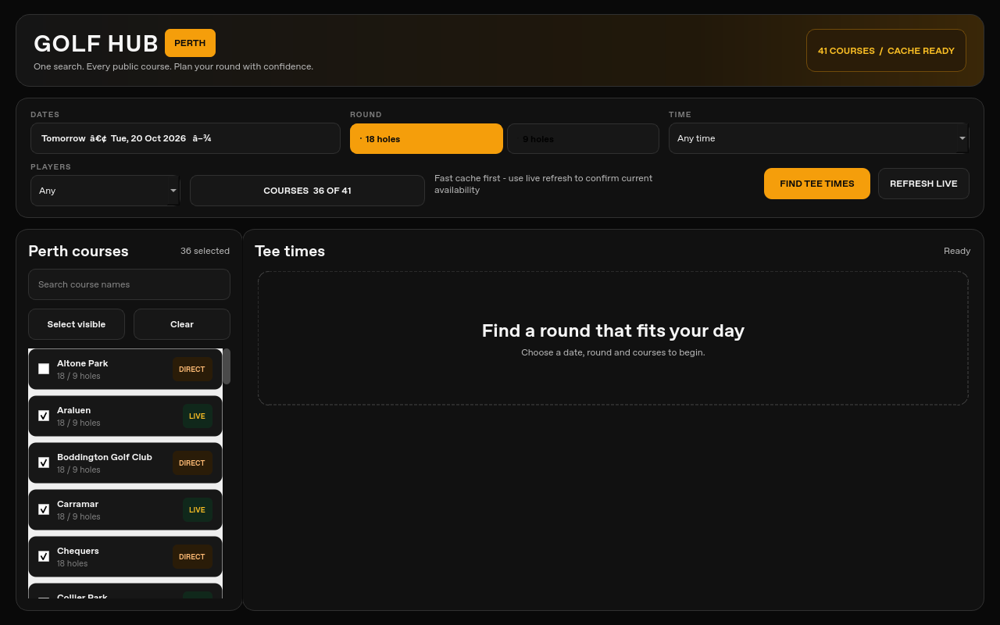
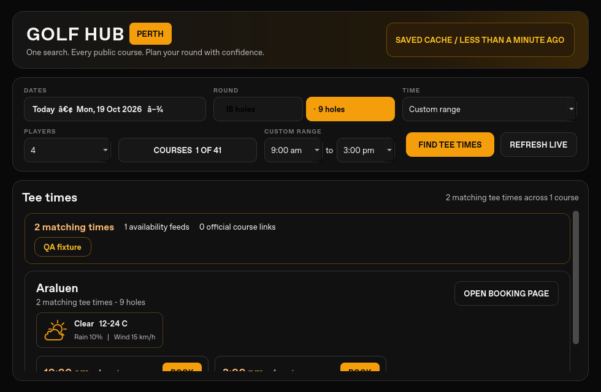

# QA pass: 19 October 2026 Perth

## Scope and provenance

Today's repair branch is based on unchanged draft [#10](https://github.com/Jarryd22/golfhub-perth/pull/10), `99057788e335fa8d50e0e353c2ca5613917bf600`, which depends on #9. Main remains `25de15b65af6f9dcad4a4d13788fb87ab976df31`. Inspected current remote branches, all eight open draft PRs #3–10, open issues (none), the daily/hourly task definitions, both update repositories, [yesterday's report](../2026-10-18/REPORT.md), the cumulative checklist and backlog before editing. No additional repair task was found. This does not duplicate #3–8 reliability repairs or #9–10 date/calendar work.

The authorized saved cloud environment is Linux, Python 3.12.14, PySide6 6.12.0, Qt offscreen; a separate Qt 6.11.1 environment checks the new regressions too. The checkout was clean at older remote main before fetching #10. There is no AGENTS.md or applicable `.agents/skills` in this cloud checkout. The offline desktop's newer dirty source is unavailable here and was not changed or represented as tested. All app/cache/test state is isolated under temporary directories.

## Focused repair and before/after evidence

1. **Course selection count:** a real checkbox click removed Altone Park from the selected set (37→36), but the label stayed “37 selected” and Qt raised `toggled() only accepts 0 argument(s), 1 given!`. Adapt the checkbox state argument before emitting the existing no-argument course-row signal. This explicitly carries the one-line solution already identified in the prior local-source backlog, with regression coverage; it is not a competing redesign. Checkbox, Space key, whole-row clicks, bulk selection, filtered hidden selections and 18→9→18 now retain truthful counts.
2. **Control identification:** course checkboxes expose their course name and checked state. Focusable fields have label buddies; Players and Time have explicit names. Search keeps its name after typing. Literal ampersands in course names are escaped for the new label buddy so “Serpentine & Districts” stays intact; independent review caught this edge and the regression covers it.
3. **Search clarity:** the hint now says “Search course names”, matching the existing case-insensitive name search. Suburb search is not introduced.

The final eight-test regression suite fails on untouched #10 (53 failing assertions/subcases, all eight methods affected) and passes all eight after repair, on Qt 6.12 and 6.11.1. Before/after probes show 37→36 with a stale label before and a correct “36 selected” after; full probe callback errors fall 44→0. The separate 16-check smoke tool reports 42→0 callback errors.

[Baseline regression log](course-controls-baseline.log) · [Repaired log](course-controls-after.log) · [Qt 6.11.1 log](course-controls-qt611.log) · [Before probe](journey-probe-before.json) · [After probe](journey-probe-after.json)

## Validation and honest limits

- **143 branch test cases passed, 2 failed, 4 blocked**, counted once across isolated module processes and targeted rechecks. Includes all eight new controls tests and 43 existing cache tests. [Final summary](test-summary.json), [initial outcomes](test-summary-initial.json), [rechecks](test-rechecks.json).
- Both failures reproduce on untouched #10: the obsolete cron expectation (`*/10` versus offset minutes), and an inherited Windows-specific combo-box accessibility assertion. Neither assertion is changed in this draft. The new tests use portable label/property checks and actual Qt accessibility relationships.
- On Unix, Qt deliberately exposes a combo's current value as its accessible Name and identifies its label through relationships. The minimal probe reproduces this on 6.11.1 and 6.12.0; it is not a newly discovered app or Qt regression. [Qt implementation](https://github.com/qt/qtbase/blob/v6.12.0/src/widgets/accessible/complexwidgets.cpp), [probe](qt-accessibility-probe.py), [6.12 evidence](qt-accessibility-6.12.0.json), [6.11 evidence](qt-accessibility-6.11.1.json). Real screen-reader behavior remains unverified; Start/End controls' Linux label relationships remain a follow-up.
- Four static WebEngine dialog cases are blocked by the cloud image's Chromium SUID sandbox helper configuration. Sandbox protections were not disabled or changed. Five pure booking-dialog interpreter tests pass separately. No live provider was contacted.
- Initial `booking_ui_integration` and `golfhub_v3` processes aborted at Qt shutdown after their assertions. Rechecks use existing `cleanup_qt_widgets()` externally after unittest, while QApplication is alive; they exit normally with six passes and sixteen passes/one known cron failure respectively. No failure was hidden. Original logs remain. Generalizing fixture cleanup in older suites is backlog work.
- **16 offscreen smoke checks pass**: fresh-state construction, course-name search, cache rendering, intercepted booking handoff, dates, 9/18 holes, group/time filters, no matching times, provider errors, unavailable weather, offline with/without saved data, range correction and 980×640/1280×800/1600×1000 layouts. This exercises source widgets with mocked networking, not an installed client. [Smoke evidence](journey-smoke-after.json). One initial after-smoke process exited 139; unchanged reruns completed, recorded in the journey summary. It is retained as a Qt harness limitation.
- **148 course/date/round combinations** pass intercepted Qt course-card clicks: 41 configured courses, 37 applicable for each round, two days/both rounds. Links are inspected and intercepted, not visited. This does not prove booking-provider uptime or availability.
- actionlint **v1.7.12** passes; official release binary SHA-256 checked against its release checksum file (`8aca8db96f1b94770f1b0d72b6dddcb1ebb8123cb3712530b08cc387b349a3d8`). CRLF-aware whitespace and compile checks pass. Independent review's ampersand finding was repaired and tested.
- Existing read-only Windows desktop CI now includes these eight tests, **43 focused cases** total. Cache CI remains 43 cache tests plus actionlint. Only test workflow paths/module lists changed; production workflows are untouched. Exact remote head and CI results are recorded in the draft PR after push.

Visual inspection confirms the count and search-hint changes and reachable main actions at the tested sizes. Existing broken date punctuation and platform styling differences remain visible. No golfer interviews, user-feedback claims, design overhaul or monetization decision are part of this pass. The practical improvement is a course selection users can identify and trust on repeat searches.

## Weather and freshness boundary

The supplied 07:58 Perth hourly audit is context, not a whole-cache audit repeated here. Exactly three public 18-hole payloads were sampled at 08:22 Perth: Oct 19 and Nov 3 each have 37 finite, plausible numeric forecasts and no Clear/all-zero pattern; Nov 4 has 37 expected nulls. Publication times are 08:16:10–08:16:30 Perth. Wembley configured-product errors remain on Nov 3/4. Numeric tests exclude booleans/nonfinite values, enforce plausible ranges/order, and flag all-zero Clear separately; non-null alone is not a quality test. [Sample evidence and bounds](journey-cache-sample.json).

These three samples support persistence of the already-observed source-data recovery, not deployment of PR #8. They contain no forecast-source timestamp, so numeric plausibility cannot establish observation age or forecast accuracy. No weather/provider request was made. A synthetic fresh publication carrying a two-hour-old stale course still shows “less than a minute ago” without a card stale warning; partial/zero synthetic weather still exposes the existing parser/rendering gap. Keep #4→#6→#8 and existing local freshness/subset preservation work as the repair path, without a duplicate implementation.

## Releases and safe alert checks

Current releases remain [Windows 5.1.17](https://github.com/Jarryd22/golfhub-perth-updates/releases/tag/v5.1.17) and [Android 0.1.19](https://github.com/Jarryd22/golfhub-perth-android-updates/releases/tag/android-v0.1.19). Both distribution repositories have only main and no open PRs; returned releases are not drafts/prereleases. Latest and versioned manifest bytes agree, and manifest digests/sizes plus decoded binary URL/hash/size match GitHub metadata. **Signature verification was not rerun:** no trusted updater key/source is available here. No installer or APK was downloaded or executed. [Release audit](release-alert-summary.md).

Loose service source cannot import the missing dependencies. However, production's checked-in workflow explicitly extracts `.github/alerts-runtime.zip`, which contains those modules; this is a source-reconciliation gap, not proof of an outage. **10/10 separate deterministic audit cases pass** against that archive's pure alert logic with sockets blocked. Archive cases are not branch-test or Android-delivery counts. Root alert suites are import-blocked; worker/delivery tests are not run because `firebase_admin` is absent. No Firebase client, worker main, authentication or send path ran. The supplied zero-watch heartbeat observation still does not establish delivery. [Source/runtime evidence](release-alert-service.json), [reproducible audit](release-alert-audit.py).

## Remaining decisions

Review dependencies #9→#10→this draft before integration; no behavior is deployed. Choose a canonical desktop/mobile source before integrating the offline desktop's newer changes. Prioritize stale-data truthfulness and source/runtime reconciliation, then repeated booking-button context, Start/End Linux label relationships, native keyboard/screen-reader checks and remaining test portability/cleanup. See the updated [backlog](../../IMPROVEMENT_BACKLOG.md) and [checklist](../../QA_CHECKLIST.md).

No native Windows/Android/device, real screen-reader, DPI, updater install or real notification test was performed. No merge, deployment, release, production dispatch, credential/security change, spending, third-party message, booking or temporary provider hold occurred.
