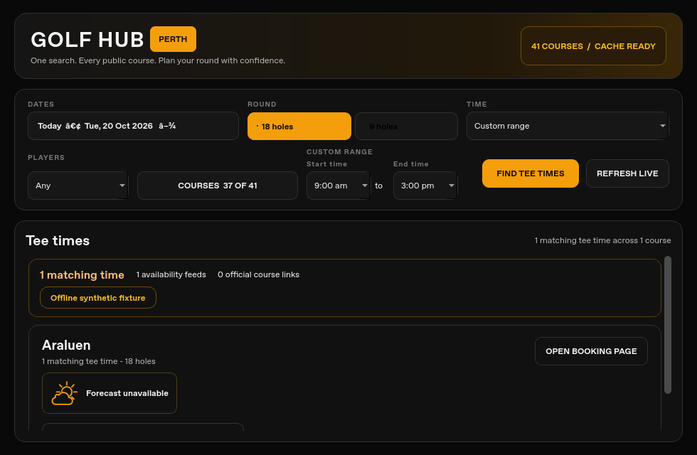

# QA pass: 20 October 2026 Perth

## Scope and repair choice

This daily pass is based on unchanged draft [#11](https://github.com/Jarryd22/golfhub-perth/pull/11), commit `6d60354a90d7a32807a3f7867cb9180d449433ce`, after #9 and #10. Main remains `25de15b65af6f9dcad4a4d13788fb87ab976df31`. All nine open drafts #3–11, remote branches, open issues (none), update repositories, previous reports, cumulative checklist and prioritized backlog were inspected first. #11's existing desktop/cache CI remains green. [Inspection evidence](inspection.json).

The available checkout was clean at main. There is no AGENTS.md or applicable `.agents/skills` in this workspace. Testing used an isolated Python 3.12.14 environment with PySide6/Qt 6.12.0 on Linux offscreen; temporary app/cache directories and blocked/intercepted network/browser calls keep fixtures separate from user state. No native Windows/Android or installed-release behavior is claimed.

Per-course stale labels and selected-subset cache replacement still reproduce. The prior reports identify fixes already present in the unavailable local desktop source, so this pass leaves that reconciliation work intact. The existing #4→#6→#8 weather repair and #5→#7 Wembley work were not duplicated. The chosen small usability repair addresses the independently reproducible action/label accessibility gaps left in the backlog.

## Before and after

- **Repeated actions:** before, Qt reports every tee-time button simply as `BOOK`, with no course, time, round or date. After, an example name is `Book: Araluen, 10:00 am, 18 holes, 20 October 2026`. Course/calendar links and Show all/Show first controls also expose their displayed context. Visible button text, URLs, handler objects and booking behavior are preserved.
- **Date accuracy:** single-day context comes from the submitted search; lazy multi-day sections capture their own dates. Editing unsubmitted filters cannot rename an existing result. Course links shown once for a whole date range do not invent one date. Missing context is omitted rather than guessed; literal ampersands remain intact. Collier's final official-calendar action keeps the correct name.
- **Custom range:** Start/End previously had properties but no actual Qt Label relationships, leaving Unix accessibility interfaces with only values such as `9:00 am`. Both now have visible buddy labels and actual Label relationships. The existing test now checks portable properties and relationships, replacing its Windows-only combo Name assertion.

All **8 new booking-context tests fail on untouched #11** (13 assertions/subcases) and pass after repair. The updated time-label regression fails on #11 for both missing label relationships; all **5 time-range tests pass** after repair. Tests exercise real Qt accessibility interfaces, keyboard Space activation with intercepted handoff, multi-day lazy construction, official action variants, row URL precedence, missing context and expanded/collapsed action names.

[Before evidence](booking-context-before.json) · [After evidence](booking-context-after.json) · [Baseline booking regressions](booking-context-baseline.log) · [Repaired regressions](booking-context-after.log) · [Baseline labels](time-labels-baseline.log) · [Repaired labels](time-labels-after.log)

Visual and geometry inspection at **980×640** confirms both 91×40 custom controls and their labels are inside the window, with search/live/course actions reachable. Existing date punctuation corruption remains visible and belongs to the documented local-source reconciliation work. The source screenshot is not a native screen-reader, display-scaling or touch-target test.

## Daily validation

- **152 branch test cases passed, 1 failed, 4 blocked**, counted once across isolated final module runs. Baseline #11: 143 passed, 2 failed, 4 blocked. The eight new tests and corrected directly related portability assertion explain the difference. [Final module results](qa-after-summary.json) · [Baseline results](qa-baseline-summary.json) · [Reproducible runner](qa-run-modules.py).
- The sole failure is the unchanged obsolete cron expectation in `test_golfhub_v3.py`; it reproduces on #11. Production scheduling is unchanged. Four static WebEngine tests cannot start because of this image's Chromium SUID sandbox-helper configuration. The sandbox was not disabled or changed. Five pure booking-dialog interpreter cases pass separately.
- Explicit fixture cleanup destroys widgets while QApplication is alive; all broad module processes finish normally. The final threaded smoke is blocked: two processes segfaulted in the unchanged `cache_thread_done` slot, and an explicit wrapper-lifetime experiment stalled. Untouched #11 also crashed on its first smoke run, then passed an unchanged diagnostic rerun. These are not counted as final journey passes or established native-device defects. A separate synchronous-cache fixture covers controls/rendering while bypassing worker lifecycle; it is clearly labeled in the journey evidence.
- Prior fixes remain verified: six Perth-date tests, five time-range tests, eight actual-focus keyboard calendar tests, eight course-control tests, twelve multi-day tests and four search-race tests pass. The original course-count and unnamed course/filter regressions remain fixed.
- **18 separate synchronous-cache fixture journey checks pass**, covering first launch, name search, dates, 18→9→18, players/time, coverage, intercepted booking, empty/provider-error/offline saved/no-cache states, unavailable weather and 980×640–1600×1000 layout. The enhanced smoke additionally exercises all **28 dates** and **25 player/time combinations** (Any/1–4 and all presets). Its final status and process limitations are recorded in [journey evidence](journey-summary.json).
- **148 course/date/round handoffs** pass: all 41 configured courses, 37 eligible for each round, two dates and both rounds. Course-card opens are intercepted; URLs are checked without visiting providers or creating holds. The reusable probe corrects yesterday's direct-result argument order and blocks weather lookup. Zero Qt callback exceptions were captured. [Final link/coverage evidence](journey-probe-after.json).
- Workflow checks use checksum-verified **actionlint v1.7.12** (`8aca8db96f1b94770f1b0d72b6dddcb1ebb8123cb3712530b08cc387b349a3d8`); CRLF-aware whitespace and compile checks pass. Test-only Windows CI now selects **51 focused desktop tests** (43 inherited + 8 new); cache CI remains 43 tests plus actionlint. Production workflows are unchanged. Final commit/tree and exact-head CI results are recorded on the draft PR after push.

## Weather and freshness boundary

The supplied **07:44 Perth hourly audit** is context, not a repeated whole-cache audit: main/update versions unchanged, 56 files / 2,072 records / 41 courses, October 20–November 16, both rounds. Its 74 November 4 false Clear/all-zero summaries are already covered by draft #8 and the earlier user warning. No fresh provider or cache-quality audit was performed here, and no recovery is attributed to this undeployed branch. Expected later null forecasts and Wembley's release-horizon limits remain distinct from defects.

Synthetic source-widget checks still show a fresh publication containing a two-hour-old stale course without a stale-card warning, and the existing partial/zero weather display gap. Batch publication timestamps cannot establish course observation or forecast-source age. Keep the existing freshness/subset and weather integration paths; these are not new repair claims.

## Releases, alerts and remaining work

[Release/alert summary](release-alert-summary.md): Windows **5.1.17** and Android **0.1.19** remain unchanged; both repositories have only main and no open PRs. Current manifest aliases, digests, sizes and decoded binary metadata agree. Signatures were not rerun without a trusted updater key; binaries were not downloaded or installed.

**10 separate socket-blocked archived alert-logic audit cases pass.** The workflow/archive match main and #11. Loose source remains incomplete; root service tests cannot import missing modules. Worker/delivery tests remain blocked by missing `firebase_admin`. No Firebase client, worker main or send path ran. The zero-watch/zero-shared-observation heartbeat does not verify device delivery.

The [cumulative checklist](../../QA_CHECKLIST.md) and [prioritized backlog](../../IMPROVEMENT_BACKLOG.md) retain canonical desktop/mobile source reconciliation, existing stale/subset fixes, loose alert/runtime provenance, pending reliability drafts, midnight rebasing, mobile map/keyboard/tap-target checks, native screen-reader/keyboard/scaling/updater tests and Qt smoke instability. Independent review is recorded in [review.md](review.md).

**Decision needed:** choose the canonical desktop/mobile candidate and review the existing dependency stack before integration. This pass creates a reviewable draft only. No merge, deployment, release, production dispatch, credential/security change, spending, third-party message, booking, temporary hold or real notification occurred.
